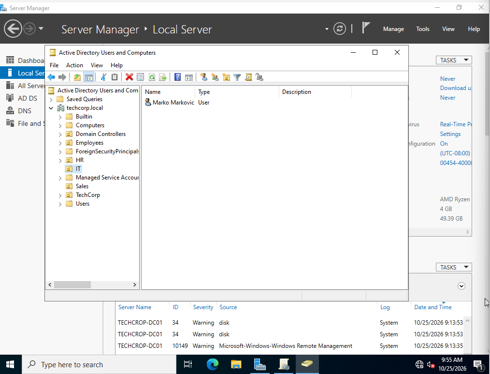
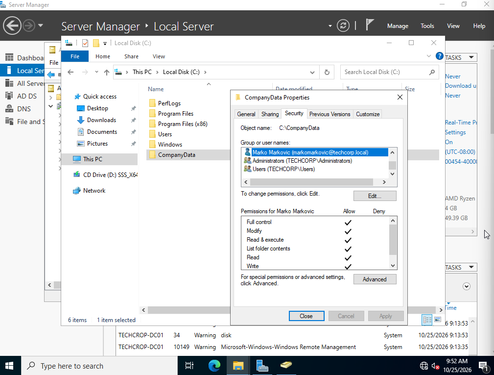
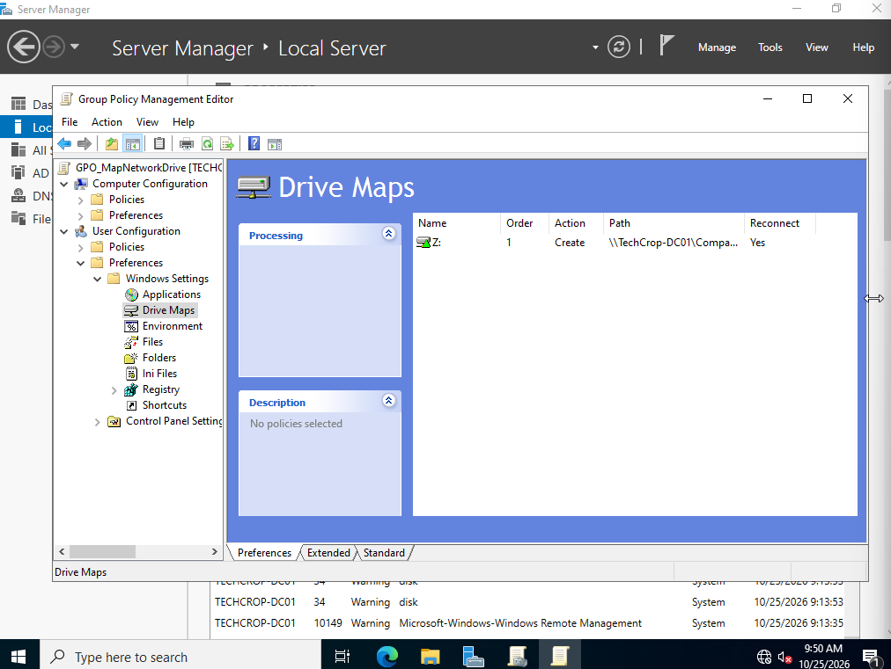

# 🛠️ System Administration & IT Support Home Lab

[ 🇬🇧 English ] | [ 🇩🇪 Deutsch ]

---

## 🇩🇪 Über dieses Projekt (Deutsch)
Willkommen in meinem IT-Praxis-Portfolio! In diesem Repository dokumentiere ich meine praktischen Übungen, Systemkonfigurationen und praxisnahen Troubleshooting-Szenarien in der Netzwerk- und Systemadministration. 

Mein Ziel ist es, ein tiefes praktisches Verständnis für moderne IT-Infrastrukturen (On-Premise & Cloud) zu demonstrieren und reale administrative Aufgaben effizient zu lösen.

---

## 🇬🇧 About This Project (English)
Welcome to my hands-on IT portfolio! In this repository, I document my practical exercises, system configurations, and real-world troubleshooting scenarios in Network and System Administration.

My goal is to demonstrate a solid, practical understanding of modern IT infrastructure (On-Premise & Cloud) and to solve everyday administrative tasks efficiently.

---

## 📐 Lab Architecture / Laborarchitektur

- **Hypervisor:** Oracle VM VirtualBox
- **Directory Services:** Windows Server 2022 (Active Directory Domain Services)
- **Cloud Infrastructure:** Microsoft 365 Developer Tenant (Entra ID / Exchange Online)
- **Linux Environment:** Ubuntu Server (SSH, CLI Management)
- **Workstation:** Windows 11 Enterprise (Joined to Domain)

---

## 📂 Projects & Configurations / Projekte & Konfigurationen

### 1. Active Directory & Windows Server (AD DS)
- **Domain Setup:** Deployment of `techcorp.local` domain environment on Windows Server 2022 (`TechCrop-DC01`).
- **OU Structure & RBAC:** Designed Organizational Units (`TechCorp` -> `IT`, `HR`, `Sales`, `Employees`) following the **Least Privilege Principle**.
- **User Management:** Provisioned domain users (e.g., `Marko Markovic` - `markomarkovic@techcorp.local`) with complete Kerberos UPN attributes.
- **File Services & NTFS Security:** Configured SMB share (`CompanyData`) with `Everyone: Full Control` share permissions and restricted filesystem security via explicit NTFS ACLs for `TECHCORP\markomarkovic`.
- **Group Policy Management (GPO):** Configured central automation via `GPO_MapNetworkDrive` to automatically map the SMB share `\\TechCrop-DC01\CompanyData` to drive letter **`Z:`** upon user logon.

#### 📸 Proof of Implementation:
| Active Directory Hierarchy | NTFS Security Permissions | Group Policy Mapping |
| :---: | :---: | :---: |
|  |  |  |

---

### 2. Microsoft 365 & Entra ID (Cloud Administration)
- **Tenant Management:** Hands-on administration via Microsoft 365 Admin Center (`admin.microsoft.com`).
- **Shared Mailboxes:** Created and configured cost-effective Shared Mailboxes (e.g., `support@techcorp-lab.com`) with delegated access permissions (Full Access / Send As).
- **Security & Licensing:** License allocation optimization and Multi-Factor Authentication (MFA) enforcement.

---

### 3. Network Troubleshooting & Diagnostics
- **Methodology:** Systematic "Bottom-Up" troubleshooting approach (Physical -> IP Layer -> DNS Resolution).
- **CLI Tools Used:** `ping`, `ipconfig /flushdns`, `nslookup`, `tracert`, `netstat`.
- **DNS Incident Resolution:** Diagnosed DNS failure scenarios and implemented fallback configurations to public DNS resolvers (Google `8.8.8.8` / Cloudflare `1.1.1.1`).

---

### 4. Linux Server Administration (Ubuntu CLI)
- **Remote Access:** Secure remote server management via SSH (Port 22).
- **File System & Permissions:** Command-line navigation (`cd`, `ls -la`, `pwd`) and privilege escalation (`sudo`).
- **Log Analysis:** System diagnostics and log inspection using `grep`, `tail -f`, and `journalctl`.

---

## ✉️ Contact / Kontakt
- **LinkedIn:** www.linkedin.com/in/mrmarkovic29
